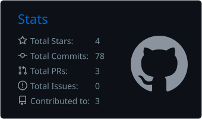
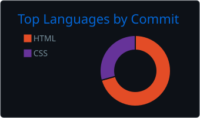

# 👋 ¡Hola! Soy Cristian Pastor Sáez

### Diseño e implemento infraestructuras IT eficientes, preparadas para escalar.

🧑‍🔧 Técnico en SMR · 👨‍🎓 Estudiante de DAM · 💼 TecnoTrack

  
  
  

  
  
  

---

## 🧑‍💻 Sobre mí

- 🔧 Me apasiona crear proyectos donde aplico mis habilidades y aprendo otras nuevas.
- 🏗️ Diseño e implemento infraestructuras IT eficientes, pensadas para anticiparse a problemas y escalar a largo plazo.
- 💼 Compagino mis estudios de DAM con mi trabajo en TecnoTrack.
- 🤖 Investigo sobre informática e IA para estar en la vanguardia tecnológica.
- 📈 Mentalidad de superación y aprendizaje continuo.

> *"Un problema imposible es simplemente aquel que superó el esfuerzo de quien más lo intentó."*

---

## 💻 Tecnologías

<table>
  <tr>
    <td align="right"><b>Lenguajes</b></td>
    <td>
      
      
      
      
      
    </td>
  </tr>
  <tr>
    <td align="right"><b>Frameworks</b></td>
    <td>
      
      
    </td>
  </tr>
  <tr>
    <td align="right"><b>Infraestructura</b></td>
    <td>
      
      
      
      
    </td>
  </tr>
  <tr>
    <td align="right"><b>Self-hosting</b></td>
    <td>
      
      
      
      
    </td>
  </tr>
  <tr>
    <td align="right"><b>Herramientas</b></td>
    <td>
      
      
    </td>
  </tr>
</table>

---

## 🚀 Proyectos destacados

| Proyecto | Descripción | Estado |
| :-- | :-- | :-: |
| 🌐 **[TecnoTrack](https://tecnotrack.es)** | Consultoría TI para empresas: infraestructura y redes, automatización, optimización de sistemas y autoridad digital. Incluye blog técnico. | 🟢 |
| 🛠️ **[AppSolve](https://app.tecnotrack.es)** | App de diagnóstico para Windows 10/11: analiza procesos, registro y eventos en local y da soluciones paso a paso en español. | 🟡 Próximamente |
| 🗂️ **[Git](https://git.tecnotrack.es)** | Servidor Git propio (Gitea) para los repositorios internos de TecnoTrack. | 🟢 |
| ✉️ **[Mail](https://mail.tecnotrack.es)** | Servidor de correo propio con webmail, SSO y acceso FIDO2/WebAuthn. | 🟢 |
| 📚 **[Docs](https://docs.tecnotrack.es)** | Wiki de documentación interna (Wiki.js). | 🟢 |
| 💬 **[Chat](https://chat.tecnotrack.es)** | Mensajería interna del equipo (Rocket.Chat). | 🟢 |

---

## ⚡ Ahora mismo

- 🛠️ Preparando el lanzamiento de **AppSolve**.
- ✍️ Escribiendo en el [blog técnico de TecnoTrack](https://tecnotrack.es/blog).

---

## 📊 Estadísticas en GitHub

  
  

---

## 📫 Contacto

  <a href="mailto:prfssionalcuentacps@gmail.com">prfssionalcuentacps@gmail.com</a> · <a href="mailto:cristian@tecnotrack.es">cristian@tecnotrack.es</a>

